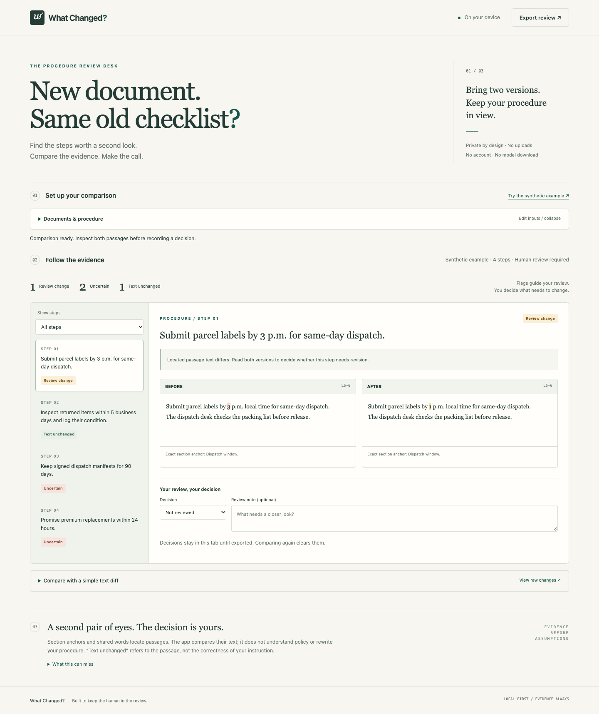

# What Changed?

A local review desk for people who maintain procedures when reference documents change. Compare two document versions against a saved checklist, inspect exact passages from both versions, and record a human decision.

## Run

Requires Node.js 20+ and a modern desktop browser. No package installation, API key, account or model download is required.

```sh
npm start
```

Open **http://127.0.0.1:4173**. Choose **Try the synthetic example**, then **Compare versions**. The server binds only to your own machine. Stop it with Ctrl+C. Use `PORT=4174 npm start` to select another port.

## Review a document change

1. Paste two versions of a plain-text or Markdown reference document, or import UTF-8 `.txt` / `.md` files.
2. Add a procedure, one instruction per line. For stronger traceability, prefix a step with its source heading:
   ```text
   [Dispatch window] Submit parcel labels by 3 p.m. for same-day dispatch.
   [Returns] Inspect returned items within 5 business days.
   ```
   The heading must occur exactly once in each document. Matching ignores heading case/punctuation. Without an anchor, the app tries shared-word retrieval.
3. Compare. Select each step and read the old/new passages, line numbers and matching reason.
4. Mark a decision—revise, keep or investigate—and add an optional note. Export the complete JSON review before closing the tab.

**Review change** means a located passage differs. **Text unchanged** means the located passage matches after whitespace normalization; it does not validate the instruction. **Uncertain** means evidence is missing, weak, ambiguous or potentially misleading. The app never generates a replacement procedure or decides that a missing passage repealed an instruction.

Save explicitly to retain the procedure in this browser. The reference documents and decisions are kept in tab memory only. Editing an input invalidates results and clears old decisions. Comparing again starts a new review. Exported JSON includes both full documents and notes, so treat it as you would the source documents.

## Reproducible checks

```sh
npm test
npm run evaluate
```

Optional resource check: `node scripts/resource-check.mjs` records a bounded synthetic run in `docs/resource-check.json`.

The built-in Node test runner verifies categories, exact source offsets/line numbers, CRLF/Unicode, negation/numeric/case changes, ambiguity, input limits, raw-diff reconstruction and visual-span preservation. The diagnostic evaluation reports **10/12 desired routing outcomes**, including **two disclosed misses**, not a real-world accuracy estimate. See [evaluation](docs/evaluation.md) and [limitations](docs/limitations.md).

Optional browser QA uses a separate Playwright installation and installed Chrome. It is development tooling, not an app dependency. With the server running:

```sh
npm install --no-save --package-lock=false playwright
node scripts/browser-check.mjs
node scripts/record-demo.mjs
```

Alternatively set `PLAYWRIGHT_MODULE` to the absolute path of an existing Playwright package. `BROWSER_CHANNEL` defaults to `chrome`. Recording uses Playwright's FFmpeg helper; a fresh Playwright installation may require `npx playwright install ffmpeg`. No AI model is involved. Browser QA writes screenshots, example export and observed results into ignored `artifacts/`. Recording writes `demo/what-changed-demo.webm` and a synthetic review export. The recording script adds captions to its isolated browser page, not to application source.

## Demonstration

[Watch the public demonstration on YouTube](https://youtu.be/vTV7kH7ZSBE). Public access and playback were verified without signing in.



All Harbor Desk documents are **synthetic**, authored for this project. They are not a real company's policy. [Demo guide](demo/README.md) lists the recording, chapter timings and verification. The recording shows the running app, changed/unchanged/missing/misleading evidence, a human review decision, export and the raw diff.

## Architecture and boundaries

Dependency-free browser JavaScript. A tiny Node HTTP server serves an allowlist of assets over loopback. All comparison and storage run in the browser. No analytics, outbound API calls or hosted service. Local storage is not encrypted and browser extensions or shared-device users may access it.

The engine uses exact section anchors and conservative lexical matching. It has no runtime generative AI or semantic entailment model. AI assistance was used to plan, implement, test and prepare documentation through the Devpost Learn Skill Pack. This is an AI-assisted development entry, not a claim of a new AI algorithm.

English plain text/Markdown only; 80,000 characters per reference document, 30,000 per procedure and 100 steps. Raw line diff is limited to 1,500 lines per document. The review engine still runs above that diff-line limit.

## Plans and provenance

- [Scope](devpost/scope.md), [PRD](devpost/prd.md), [technical spec](devpost/spec.md), [build checklist](devpost/checklist.md)
- [Offline app map](devpost/app-map.html)
- [Skill workflow and adaptations](docs/workflow.md), [rules verification](docs/contest-rules.md)
- [Submission draft](docs/submission-draft.md), [publication checklist](docs/publication-checklist.md)

Started from an empty project directory on October 15, 2026. No previous project code reused. The installed Devpost Learn Skill Pack lives in `.agents/skills/` under its original MIT license. Original application code and synthetic demo material use the root MIT license. No other third-party app source, graphics, fonts or music are bundled. Playwright/Chrome/FFmpeg used for local QA/recording are external development tools and are not redistributed.

The user authorized publication and submission. The [source repository](https://github.com/DavidKotyk/what-changed) and [demo video](https://youtu.be/vTV7kH7ZSBE) are public and verified. The Devpost entry awaits required personal registration answers. See docs/publication-status.json for the latest verified state.
